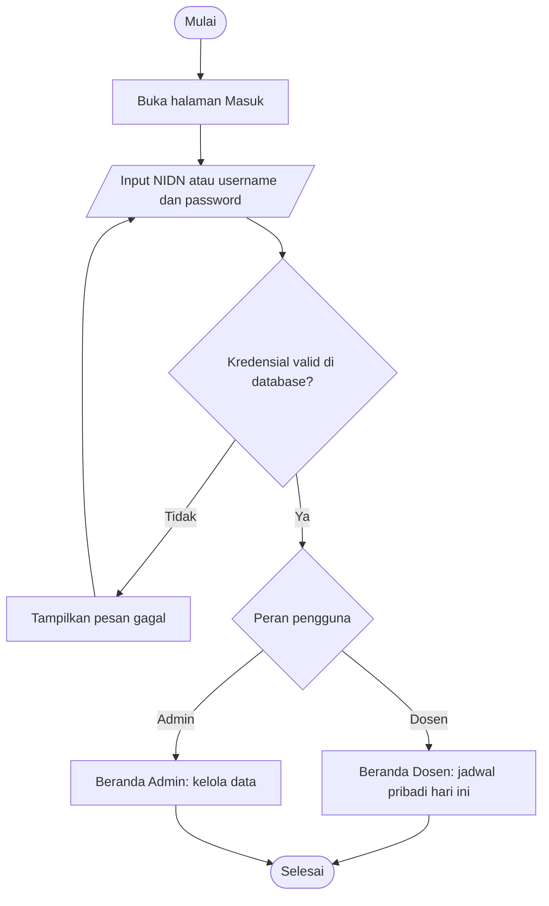
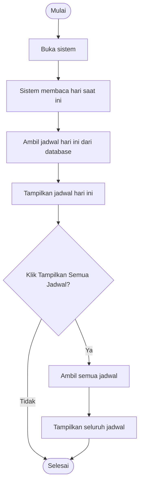
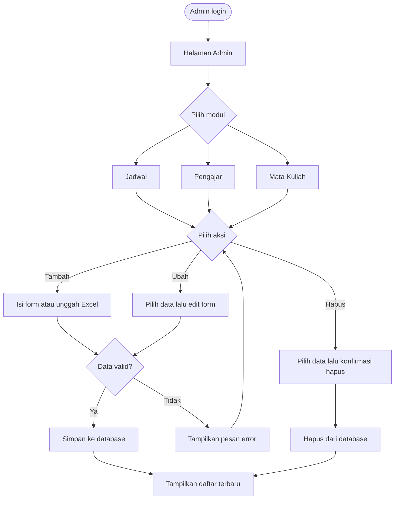
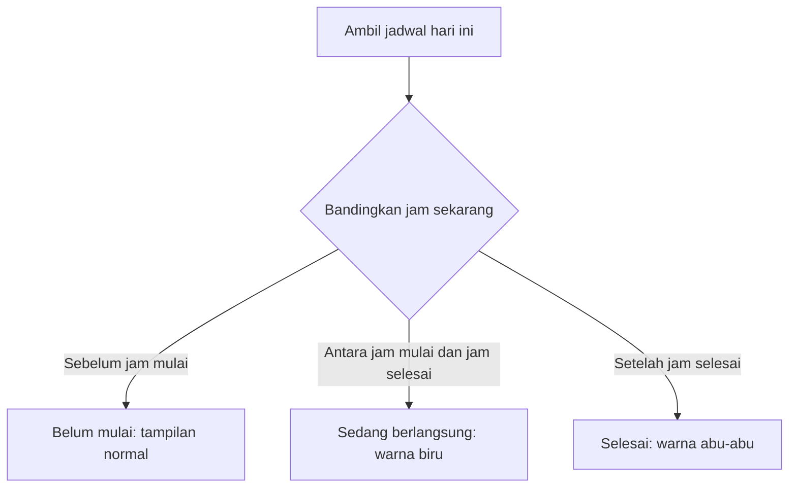
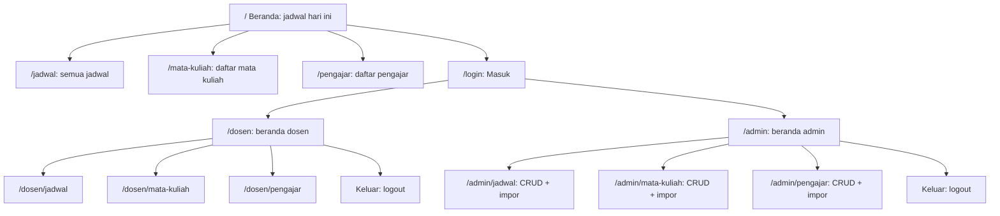
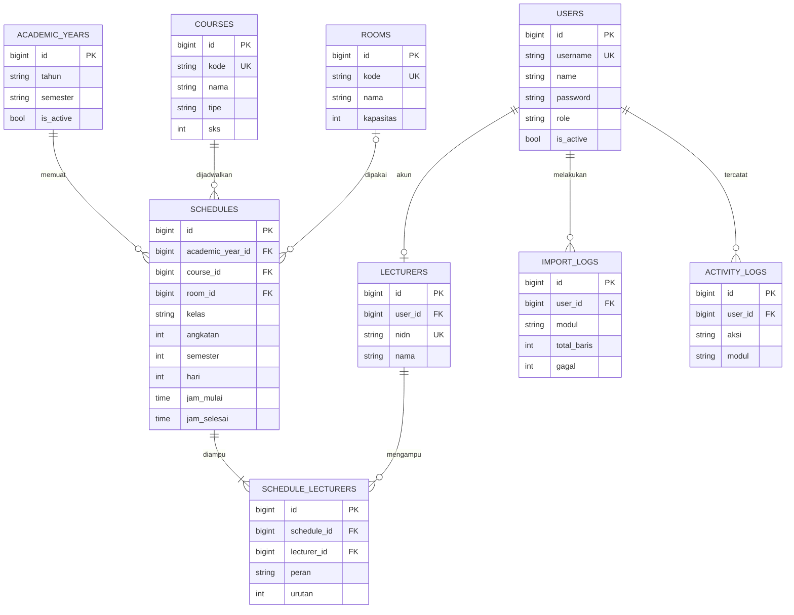

# PRD – Sistem Informasi Jadwal Perkuliahan Jurusan Teknik Informatika

Product Requirements Document · Versi 1.0 · Berdasarkan artikel Bunduwula dkk., *Jurnal Sistem Informasi dan Sistem Komputer* Vol. 9 No. 1 (2024), DOI 10.51717/simkom.v9i1.353

## 1. Ringkasan

Jurusan Teknik Informatika Universitas Halu Oleo belum memiliki sistem khusus yang menginformasikan jadwal perkuliahan dan dapat diakses dosen maupun mahasiswa. Produk ini adalah **website sistem informasi jadwal perkuliahan** yang menampilkan jadwal, daftar mata kuliah, dan daftar pengajar, serta menyediakan panel admin untuk mengelola data. Pengembangan mengikuti metode **Waterfall** dengan pemodelan UML, implementasi PHP + Laravel, dan basis data MySQL.

## 2. Latar Belakang dan Masalah

- Tidak ada sumber jadwal tunggal khusus jurusan yang mudah diakses.
- Dosen sulit merencanakan kegiatan lain (penelitian, bimbingan, pertemuan dengan mahasiswa) tanpa jadwal yang jelas.
- Pencarian informasi jadwal memakan waktu dan rawan tidak akurat.
- Pihak kampus perlu jadwal terstruktur agar sumber daya (dosen, ruang, waktu) termanfaatkan maksimal.

## 3. Tujuan dan Metrik Keberhasilan

| Tujuan | Metrik / Indikator |
| --- | --- |
| Mahasiswa dan dosen mengakses jadwal dengan mudah | Jadwal hari ini tampil otomatis di halaman awal tanpa login (mahasiswa) |
| Informasi jadwal akurat dan terkini | Admin dapat tambah/ubah/hapus jadwal; perubahan langsung tampil |
| Dosen dapat merencanakan kegiatan lain | Dosen melihat jadwal pribadi setelah login, dengan status selesai/berlangsung |
| Efisiensi pengelolaan data | Impor data jadwal, dosen, dan mata kuliah sekaligus via Excel |
| Sistem sesuai kebutuhan | 100% skenario black box test berstatus *Sesuai* |
|  |  |

## 4. Ruang Lingkup

**Dalam lingkup (v1.0)**

- Tampilan jadwal harian dan seluruh jadwal
- Daftar mata kuliah dan daftar pengajar (dengan pencarian)
- Login dosen dan admin, logout
- CRUD jadwal, pengajar, dan mata kuliah oleh admin
- Impor massal dari file Excel
- Penanda status jadwal (selesai / sedang berlangsung)

**Di luar lingkup (v1.0)**

- Penjadwalan otomatis (disarankan sebagai pengembangan lanjutan)
- Notifikasi, aplikasi mobile native, integrasi SIAKAD
- Manajemen KRS/nilai

## 5. Pengguna (Aktor)

| Aktor | Deskripsi | Akses |
| --- | --- | --- |
| Mahasiswa | Pengguna umum | Lihat jadwal, mata kuliah, pengajar tanpa login |
| Dosen | Pengajar jurusan | Login dengan NIDN + password; melihat jadwal mengajar pribadi, mata kuliah, pengajar |
| Admin | Pengelola jurusan | Login dengan username + password; CRUD seluruh data |

## 6. Kebutuhan Fungsional

| ID | Kebutuhan | Aktor | Prioritas |
| --- | --- | --- | --- |
| FR-01 | Halaman awal menampilkan jadwal sesuai hari saat diakses (mis. Senin → jadwal Senin) | Mahasiswa | Tinggi |
| FR-02 | Tombol "Tampilkan Semua Jadwal" menampilkan jadwal lengkap | Semua | Tinggi |
| FR-03 | Kartu jadwal memuat mata kuliah, jam, SKS, angkatan/semester/jumlah mahasiswa, kelas, dan dosen pengampu (hingga 3 dosen) | Semua | Tinggi |
| FR-04 | Halaman daftar mata kuliah (kode, nama, SKS) dengan pencarian | Semua | Sedang |
| FR-05 | Halaman daftar pengajar (NIDN, nama) dengan pencarian | Semua | Sedang |
| FR-06 | Login dosen memakai NIDN dan password; validasi terhadap database; pesan gagal jika tidak terdaftar | Dosen | Tinggi |
| FR-07 | Login admin memakai username dan password dengan validasi yang sama | Admin | Tinggi |
| FR-08 | Dosen melihat jadwal mengajar pribadi pada hari berjalan, dapat melihat semua jadwal | Dosen | Tinggi |
| FR-09 | Penanda warna: abu-abu = selesai, biru = sedang berlangsung | Dosen | Sedang |
| FR-10 | Admin menambah jadwal secara manual | Admin | Tinggi |
| FR-11 | Admin mengubah dan menghapus jadwal | Admin | Tinggi |
| FR-12 | Admin CRUD data pengajar | Admin | Tinggi |
| FR-13 | Admin CRUD data mata kuliah | Admin | Tinggi |
| FR-14 | Admin mengunggah file Excel untuk impor jadwal, pengajar, dan mata kuliah sekaligus | Admin | Sedang |
| FR-15 | Logout (menu "Keluar") | Dosen, Admin | Tinggi |
| FR-16 | Menu navigasi: Jadwal, Mata Kuliah, Pengajar, Masuk/Keluar | Semua | Tinggi |

## 7. Kebutuhan Non-Fungsional

- **Kegunaan:** antarmuka sederhana dan responsif, dapat dipakai di desktop dan ponsel.
- **Keamanan:** password disimpan ter-hash (bcrypt bawaan Laravel); proteksi CSRF; halaman admin dan dosen dilindungi middleware autentikasi dan otorisasi per peran.
- **Kinerja:** halaman jadwal dimuat kurang dari 3 detik pada jaringan kampus.
- **Keandalan:** validasi data impor Excel dan pesan kesalahan yang jelas; konfirmasi sebelum hapus.
- **Kemudahan pemeliharaan:** kode mengikuti struktur MVC Laravel; basis data terdokumentasi.
- **Ketersediaan:** dapat diakses 24/7 saat masa perkuliahan.

## 8. Alur Pengguna Utama

1. **Lihat jadwal:** masuk sistem → sistem menyesuaikan hari/waktu → ambil data jadwal → tampilkan jadwal hari ini → opsional "Tampilkan Semua Jadwal".
2. **Login (dosen/admin):** buka halaman Masuk → isi NIDN/username dan password → validasi → berhasil ke halaman pengguna, gagal kembali ke form login.
3. **Tambah jadwal:** login admin → halaman jadwal → tombol tambah (+) atau unggah Excel → data tersimpan → jadwal baru tampil.
4. **Ubah / hapus jadwal:** login admin → pilih jadwal → ubah atau hapus → konfirmasi → daftar diperbarui. Alur sama untuk pengajar dan mata kuliah.

### Flowchart

Empat alur utama sistem ditulis dalam format Mermaid agar bisa langsung disalin ke berkas `.md` dan dibaca oleh IDE/AI coding.

**1. Alur login (dosen dan admin)**



**2. Alur melihat jadwal (mahasiswa dan dosen)**



**3. Alur kelola data oleh admin (jadwal, pengajar, mata kuliah)**



**4. Penentuan status jadwal (asumsi: dihitung dari jam saat ini)**



### Peta Situs (Site Map)

Situs memiliki tiga area: publik (tanpa login), area dosen, dan area admin. Struktur menu mengikuti tampilan pada artikel; URL adalah usulan.



| URL (usulan) | Metode | Akses | Fungsi |
| --- | --- | --- | --- |
| `/` | GET | Publik | Jadwal hari ini, tombol Tampilkan Semua Jadwal |
| `/jadwal` | GET | Publik | Seluruh jadwal |
| `/mata-kuliah` | GET | Publik | Daftar mata kuliah + pencarian |
| `/pengajar` | GET | Publik | Daftar pengajar + pencarian |
| `/login` | GET, POST | Tamu | Form login NIDN/username + password |
| `/logout` | POST | Dosen, Admin | Keluar dari sistem |
| `/dosen` | GET | Dosen | Jadwal pribadi hari ini, status selesai/berlangsung |
| `/dosen/jadwal` | GET | Dosen | Seluruh jadwal pribadi |
| `/dosen/mata-kuliah`, `/dosen/pengajar` | GET | Dosen | Daftar mata kuliah dan pengajar |
| `/admin` | GET | Admin | Beranda admin |
| `/admin/jadwal` | GET, POST, PUT/PATCH, DELETE | Admin | CRUD jadwal |
| `/admin/jadwal/impor` | POST | Admin | Impor jadwal dari Excel |
| `/admin/mata-kuliah` (+ `/impor`) | GET, POST, PUT/PATCH, DELETE | Admin | CRUD dan impor mata kuliah |
| `/admin/pengajar` (+ `/impor`) | GET, POST, PUT/PATCH, DELETE | Admin | CRUD dan impor pengajar |

## 9. Desain Data

Desain data dikembangkan dari 4 tabel pada artikel menjadi 9 tabel ternormalisasi yang mendukung riwayat tahun ajaran, validasi bentrok jadwal, dan audit, dijalankan di MySQL pada Laragon (engine InnoDB, charset `utf8mb4`, collation `utf8mb4_unicode_ci`).

### 9.1 Perubahan dari Artikel

| Aspek | Artikel | Pengembangan | Alasan |
| --- | --- | --- | --- |
| Jumlah tabel | 4 (lecturers, schedules, courses, user) | 9 tabel inti (+ tabel bawaan Laravel) | Mendukung fitur baru tanpa kolom campur aduk |
| Dosen pengampu | Kolom dosen1, dosen2, dosen3 | Tabel pivot `schedule_lecturers` | Jumlah dosen fleksibel, query dan cek bentrok lebih mudah |
| Waktu kuliah | Satu kolom jam | `jam_mulai` dan `jam_selesai` bertipe TIME | Status berlangsung/selesai dan cek bentrok bisa dihitung |
| Angkatan, semester, jumlah mahasiswa | Satu kolom mahasiswa | Tiga kolom terpisah di `schedules` | Bisa difilter dan divalidasi |
| Ruang | Teks bebas | Tabel `rooms` | Cek bentrok ruang, data ruang konsisten |
| Akun | Tabel user admin; login dosen tidak jelas | `users` dengan kolom `role`, dihubungkan ke `lecturers.user_id` | Satu mekanisme autentikasi bawaan Laravel untuk admin dan dosen |
| Kunci mata kuliah | Kunci tidak jelas | `id` sebagai PK, `kode` unik | Kode bisa berubah saat revisi kurikulum tanpa merusak relasi |
| Riwayat | Tidak ada | Tabel `academic_years` | Jadwal per semester, jadwal lama tetap tersimpan |
| Audit | Tidak ada | `import_logs` dan `activity_logs` | Jejak perubahan dan hasil impor Excel |

### 9.2 Daftar Tabel

| Tabel | Fungsi | Prioritas |
| --- | --- | --- |
| `users` | Akun login admin dan dosen | MVP |
| `lecturers` | Profil dosen (NIDN, nama) | MVP |
| `courses` | Master mata kuliah | MVP |
| `academic_years` | Tahun ajaran dan semester, satu berstatus aktif | MVP |
| `rooms` | Master ruang kelas dan laboratorium | MVP |
| `schedules` | Jadwal kuliah per tahun ajaran | MVP |
| `schedule_lecturers` | Relasi jadwal dengan dosen pengampu | MVP |
| `import_logs` | Riwayat dan hasil impor Excel | Tahap 2 |
| `activity_logs` | Audit tambah, ubah, hapus, login | Tahap 2 |

Tabel bawaan Laravel (`migrations`, `sessions`, `password_reset_tokens`, `cache`, `jobs`) dibuat otomatis oleh `php artisan migrate` dan tidak dibahas di sini.

### 9.3 Diagram Relasi (ERD)



### 9.4 Spesifikasi Kolom

Semua tabel inti memiliki `created_at` dan `updated_at` (TIMESTAMP NULL). Tabel `lecturers`, `courses`, dan `schedules` juga memakai `deleted_at` (soft delete).

**`users`**

| Kolom | Tipe | Constraint | Keterangan |
| --- | --- | --- | --- |
| id | BIGINT UNSIGNED | PK, auto increment |  |
| username | VARCHAR(50) | UNIQUE, NOT NULL | Username admin, atau NIDN untuk dosen |
| name | VARCHAR(150) | NOT NULL | Nama tampilan |
| email | VARCHAR(150) | UNIQUE, NULL | Opsional, untuk reset password |
| password | VARCHAR(255) | NOT NULL | Hash bcrypt |
| role | ENUM('admin','dosen') | NOT NULL, default 'dosen' | Dasar otorisasi |
| is\_active | TINYINT(1) | NOT NULL, default 1 | Akun nonaktif tidak bisa login |
| must\_change\_password | TINYINT(1) | NOT NULL, default 0 | Paksa ganti password pada login pertama |
| last\_login\_at | TIMESTAMP | NULL |  |
| remember\_token | VARCHAR(100) | NULL | Fitur Remember me |

**`lecturers`**

| Kolom | Tipe | Constraint | Keterangan |
| --- | --- | --- | --- |
| id | BIGINT UNSIGNED | PK, auto increment |  |
| user\_id | BIGINT UNSIGNED | UNIQUE, NULL, FK users.id, ON DELETE SET NULL | Akun login dosen |
| nidn | VARCHAR(20) | UNIQUE, NOT NULL |  |
| nama | VARCHAR(150) | NOT NULL | Nama lengkap dengan gelar |
| email | VARCHAR(150) | NULL |  |
| is\_active | TINYINT(1) | NOT NULL, default 1 | Dosen nonaktif tidak muncul di pilihan jadwal baru |

**`courses`**

| Kolom | Tipe | Constraint | Keterangan |
| --- | --- | --- | --- |
| id | BIGINT UNSIGNED | PK, auto increment |  |
| kode | VARCHAR(20) | UNIQUE, NOT NULL | Contoh: EEA66053 |
| nama | VARCHAR(150) | NOT NULL |  |
| tipe | ENUM('wajib','pilihan') | NOT NULL, default 'wajib' |  |
| sks | TINYINT UNSIGNED | NOT NULL, CHECK 1 sampai 6 |  |
| semester\_ideal | TINYINT UNSIGNED | NULL | Semester yang disarankan kurikulum |
| deskripsi | TEXT | NULL |  |
| is\_active | TINYINT(1) | NOT NULL, default 1 |  |

**`academic_years`**

| Kolom | Tipe | Constraint | Keterangan |
| --- | --- | --- | --- |
| id | BIGINT UNSIGNED | PK, auto increment |  |
| tahun | VARCHAR(9) | NOT NULL | Format 2025/2026 |
| semester | ENUM('ganjil','genap') | NOT NULL |  |
| tanggal\_mulai | DATE | NULL |  |
| tanggal\_selesai | DATE | NULL |  |
| is\_active | TINYINT(1) | NOT NULL, default 0 | Hanya satu baris aktif; jadwal publik memakai yang aktif |
|  |  | UNIQUE (tahun, semester) |  |

**`rooms`**

| Kolom | Tipe | Constraint | Keterangan |
| --- | --- | --- | --- |
| id | BIGINT UNSIGNED | PK, auto increment |  |
| kode | VARCHAR(20) | UNIQUE, NOT NULL |  |
| nama | VARCHAR(100) | NOT NULL |  |
| gedung | VARCHAR(100) | NULL |  |
| kapasitas | SMALLINT UNSIGNED | NULL |  |
| jenis | ENUM('kelas','laboratorium','lainnya') | NOT NULL, default 'kelas' |  |
| is\_active | TINYINT(1) | NOT NULL, default 1 |  |

**`schedules`**

| Kolom | Tipe | Constraint | Keterangan |
| --- | --- | --- | --- |
| id | BIGINT UNSIGNED | PK, auto increment |  |
| academic\_year\_id | BIGINT UNSIGNED | FK academic\_years.id, ON DELETE RESTRICT |  |
| course\_id | BIGINT UNSIGNED | FK courses.id, ON DELETE RESTRICT |  |
| room\_id | BIGINT UNSIGNED | NULL, FK rooms.id, ON DELETE SET NULL |  |
| kelas | VARCHAR(20) | NOT NULL | Contoh: A, B, C, GANJIL/GENAP |
| angkatan | SMALLINT UNSIGNED | NOT NULL | Contoh: 2021 |
| semester | TINYINT UNSIGNED | NOT NULL, CHECK 1 sampai 14 | Semester mahasiswa |
| jumlah\_mahasiswa | SMALLINT UNSIGNED | NULL |  |
| hari | TINYINT UNSIGNED | NOT NULL, CHECK 1 sampai 7 | 1 = Senin sampai 7 = Minggu (ISO) |
| jam\_mulai | TIME | NOT NULL |  |
| jam\_selesai | TIME | NOT NULL, CHECK lebih besar dari jam\_mulai |  |
| catatan | VARCHAR(255) | NULL |  |
| created\_by | BIGINT UNSIGNED | NULL, FK users.id, ON DELETE SET NULL | Admin pembuat |
|  |  | INDEX (academic\_year\_id, hari, jam\_mulai); INDEX (room\_id, hari, jam\_mulai); INDEX (course\_id) | Mempercepat jadwal harian dan cek bentrok |

**`schedule_lecturers`**

| Kolom | Tipe | Constraint | Keterangan |
| --- | --- | --- | --- |
| id | BIGINT UNSIGNED | PK, auto increment |  |
| schedule\_id | BIGINT UNSIGNED | FK schedules.id, ON DELETE CASCADE |  |
| lecturer\_id | BIGINT UNSIGNED | FK lecturers.id, ON DELETE RESTRICT |  |
| peran | ENUM('koordinator','anggota') | NOT NULL, default 'anggota' |  |
| urutan | TINYINT UNSIGNED | NOT NULL, default 1 | Urutan tampil Dosen 1, 2, dst. |
|  |  | UNIQUE (schedule\_id, lecturer\_id); INDEX (lecturer\_id) | Satu dosen tidak dobel di satu jadwal; mempercepat jadwal pribadi dosen |

**`import_logs`** (tahap 2)

| Kolom | Tipe | Constraint | Keterangan |
| --- | --- | --- | --- |
| id | BIGINT UNSIGNED | PK, auto increment |  |
| user\_id | BIGINT UNSIGNED | NULL, FK users.id, ON DELETE SET NULL | Admin yang mengimpor |
| modul | ENUM('jadwal','mata\_kuliah','pengajar') | NOT NULL |  |
| nama\_file | VARCHAR(255) | NOT NULL |  |
| total\_baris | INT UNSIGNED | NOT NULL |  |
| berhasil | INT UNSIGNED | NOT NULL, default 0 |  |
| gagal | INT UNSIGNED | NOT NULL, default 0 |  |
| status | ENUM('selesai','sebagian','gagal') | NOT NULL |  |
| detail\_error | JSON | NULL | Nomor baris dan pesan kesalahan |

**`activity_logs`** (tahap 2)

| Kolom | Tipe | Constraint | Keterangan |
| --- | --- | --- | --- |
| id | BIGINT UNSIGNED | PK, auto increment |  |
| user\_id | BIGINT UNSIGNED | NULL, FK users.id, ON DELETE SET NULL |  |
| aksi | ENUM('login','logout','create','update','delete','import') | NOT NULL |  |
| modul | VARCHAR(50) | NOT NULL | Contoh: schedules |
| target\_id | BIGINT UNSIGNED | NULL | Id baris yang diubah |
| data\_lama | JSON | NULL |  |
| data\_baru | JSON | NULL |  |
| ip\_address | VARCHAR(45) | NULL |  |
| user\_agent | VARCHAR(255) | NULL |  |

### 9.5 Aturan Bisnis dan Integritas Data

- **Satu tahun ajaran aktif.** Saat admin mengaktifkan satu tahun ajaran, yang lain otomatis nonaktif (dalam satu transaksi). Halaman publik dan beranda dosen hanya menampilkan jadwal tahun ajaran aktif; tahun lain dapat dipilih lewat filter.
- **Tidak boleh bentrok.** Dosen, ruang, dan pasangan kelas + angkatan tidak boleh memiliki dua jadwal yang waktunya beririsan pada hari dan tahun ajaran yang sama. Dua rentang beririsan bila `jam_mulai_a < jam_selesai_b` dan `jam_selesai_a > jam_mulai_b`.
- **Minimal satu dosen** per jadwal (validasi aplikasi); dosen pertama berperan koordinator.
- **Hapus aman.** `courses`, `lecturers`, dan `schedules` memakai soft delete; data master yang masih dipakai jadwal tidak bisa dihapus permanen (ON DELETE RESTRICT).
- **Status jadwal tidak disimpan.** Belum mulai, sedang berlangsung, dan selesai dihitung dari hari dan jam sekarang pada zona waktu `Asia/Makassar` (WITA, sesuaikan bila berbeda) lewat accessor model.
- **Akun dosen otomatis.** Saat dosen ditambah atau diimpor, sistem membuat `users` dengan `username` = NIDN, `role` = dosen, password acak, dan `must_change_password` = 1. Admin dapat mereset password.
- **Impor Excel idempoten.** Mata kuliah dan dosen di-upsert berdasarkan `kode` dan `nidn`; jadwal dianggap duplikat bila tahun ajaran, mata kuliah, kelas, hari, dan jam mulainya sama. Baris gagal tidak membatalkan baris lain dan dicatat di `import_logs`.
- **Format hari** disimpan sebagai angka 1 sampai 7 agar mudah diurutkan, lalu dipetakan ke nama hari di aplikasi.

Contoh query cek bentrok dosen (isi parameter dengan `:nama`):

```sql
SELECT s.id
FROM schedules s
JOIN schedule_lecturers sl ON sl.schedule_id = s.id
WHERE s.academic_year_id = :tahun_ajaran
  AND s.hari = :hari
  AND sl.lecturer_id IN (:id_dosen)
  AND s.jam_mulai < :jam_selesai
  AND s.jam_selesai > :jam_mulai
  AND s.deleted_at IS NULL
  AND s.id <> :id_jadwal_yang_diubah;
```

### 9.6 DDL MySQL (referensi untuk HeidiSQL)

Skrip ini dapat ditempel ke tab Query di HeidiSQL. Untuk aplikasi, buat tabel lewat migration Laravel dengan struktur yang sama.

```sql
CREATE DATABASE IF NOT EXISTS jadwal_ti
  CHARACTER SET utf8mb4 COLLATE utf8mb4_unicode_ci;
USE jadwal_ti;

CREATE TABLE users (
  id BIGINT UNSIGNED AUTO_INCREMENT PRIMARY KEY,
  username VARCHAR(50) NOT NULL,
  name VARCHAR(150) NOT NULL,
  email VARCHAR(150) NULL,
  password VARCHAR(255) NOT NULL,
  role ENUM('admin','dosen') NOT NULL DEFAULT 'dosen',
  is_active TINYINT(1) NOT NULL DEFAULT 1,
  must_change_password TINYINT(1) NOT NULL DEFAULT 0,
  last_login_at TIMESTAMP NULL,
  remember_token VARCHAR(100) NULL,
  created_at TIMESTAMP NULL,
  updated_at TIMESTAMP NULL,
  UNIQUE KEY uq_users_username (username),
  UNIQUE KEY uq_users_email (email)
) ENGINE=InnoDB;

CREATE TABLE lecturers (
  id BIGINT UNSIGNED AUTO_INCREMENT PRIMARY KEY,
  user_id BIGINT UNSIGNED NULL,
  nidn VARCHAR(20) NOT NULL,
  nama VARCHAR(150) NOT NULL,
  email VARCHAR(150) NULL,
  is_active TINYINT(1) NOT NULL DEFAULT 1,
  created_at TIMESTAMP NULL,
  updated_at TIMESTAMP NULL,
  deleted_at TIMESTAMP NULL,
  UNIQUE KEY uq_lecturers_nidn (nidn),
  UNIQUE KEY uq_lecturers_user (user_id),
  CONSTRAINT fk_lecturers_user FOREIGN KEY (user_id)
    REFERENCES users(id) ON DELETE SET NULL
) ENGINE=InnoDB;

CREATE TABLE courses (
  id BIGINT UNSIGNED AUTO_INCREMENT PRIMARY KEY,
  kode VARCHAR(20) NOT NULL,
  nama VARCHAR(150) NOT NULL,
  tipe ENUM('wajib','pilihan') NOT NULL DEFAULT 'wajib',
  sks TINYINT UNSIGNED NOT NULL,
  semester_ideal TINYINT UNSIGNED NULL,
  deskripsi TEXT NULL,
  is_active TINYINT(1) NOT NULL DEFAULT 1,
  created_at TIMESTAMP NULL,
  updated_at TIMESTAMP NULL,
  deleted_at TIMESTAMP NULL,
  UNIQUE KEY uq_courses_kode (kode),
  CONSTRAINT ck_courses_sks CHECK (sks BETWEEN 1 AND 6)
) ENGINE=InnoDB;

CREATE TABLE academic_years (
  id BIGINT UNSIGNED AUTO_INCREMENT PRIMARY KEY,
  tahun VARCHAR(9) NOT NULL,
  semester ENUM('ganjil','genap') NOT NULL,
  tanggal_mulai DATE NULL,
  tanggal_selesai DATE NULL,
  is_active TINYINT(1) NOT NULL DEFAULT 0,
  created_at TIMESTAMP NULL,
  updated_at TIMESTAMP NULL,
  UNIQUE KEY uq_academic_years (tahun, semester)
) ENGINE=InnoDB;

CREATE TABLE rooms (
  id BIGINT UNSIGNED AUTO_INCREMENT PRIMARY KEY,
  kode VARCHAR(20) NOT NULL,
  nama VARCHAR(100) NOT NULL,
  gedung VARCHAR(100) NULL,
  kapasitas SMALLINT UNSIGNED NULL,
  jenis ENUM('kelas','laboratorium','lainnya') NOT NULL DEFAULT 'kelas',
  is_active TINYINT(1) NOT NULL DEFAULT 1,
  created_at TIMESTAMP NULL,
  updated_at TIMESTAMP NULL,
  UNIQUE KEY uq_rooms_kode (kode)
) ENGINE=InnoDB;

CREATE TABLE schedules (
  id BIGINT UNSIGNED AUTO_INCREMENT PRIMARY KEY,
  academic_year_id BIGINT UNSIGNED NOT NULL,
  course_id BIGINT UNSIGNED NOT NULL,
  room_id BIGINT UNSIGNED NULL,
  kelas VARCHAR(20) NOT NULL,
  angkatan SMALLINT UNSIGNED NOT NULL,
  semester TINYINT UNSIGNED NOT NULL,
  jumlah_mahasiswa SMALLINT UNSIGNED NULL,
  hari TINYINT UNSIGNED NOT NULL,
  jam_mulai TIME NOT NULL,
  jam_selesai TIME NOT NULL,
  catatan VARCHAR(255) NULL,
  created_by BIGINT UNSIGNED NULL,
  created_at TIMESTAMP NULL,
  updated_at TIMESTAMP NULL,
  deleted_at TIMESTAMP NULL,
  INDEX idx_sched_day (academic_year_id, hari, jam_mulai),
  INDEX idx_sched_room (room_id, hari, jam_mulai),
  INDEX idx_sched_course (course_id),
  CONSTRAINT ck_sched_hari CHECK (hari BETWEEN 1 AND 7),
  CONSTRAINT ck_sched_semester CHECK (semester BETWEEN 1 AND 14),
  CONSTRAINT ck_sched_jam CHECK (jam_selesai > jam_mulai),
  CONSTRAINT fk_sched_year FOREIGN KEY (academic_year_id)
    REFERENCES academic_years(id) ON DELETE RESTRICT,
  CONSTRAINT fk_sched_course FOREIGN KEY (course_id)
    REFERENCES courses(id) ON DELETE RESTRICT,
  CONSTRAINT fk_sched_room FOREIGN KEY (room_id)
    REFERENCES rooms(id) ON DELETE SET NULL,
  CONSTRAINT fk_sched_creator FOREIGN KEY (created_by)
    REFERENCES users(id) ON DELETE SET NULL
) ENGINE=InnoDB;

CREATE TABLE schedule_lecturers (
  id BIGINT UNSIGNED AUTO_INCREMENT PRIMARY KEY,
  schedule_id BIGINT UNSIGNED NOT NULL,
  lecturer_id BIGINT UNSIGNED NOT NULL,
  peran ENUM('koordinator','anggota') NOT NULL DEFAULT 'anggota',
  urutan TINYINT UNSIGNED NOT NULL DEFAULT 1,
  UNIQUE KEY uq_sched_lect (schedule_id, lecturer_id),
  INDEX idx_sl_lecturer (lecturer_id),
  CONSTRAINT fk_sl_schedule FOREIGN KEY (schedule_id)
    REFERENCES schedules(id) ON DELETE CASCADE,
  CONSTRAINT fk_sl_lecturer FOREIGN KEY (lecturer_id)
    REFERENCES lecturers(id) ON DELETE RESTRICT
) ENGINE=InnoDB;

CREATE TABLE import_logs (
  id BIGINT UNSIGNED AUTO_INCREMENT PRIMARY KEY,
  user_id BIGINT UNSIGNED NULL,
  modul ENUM('jadwal','mata_kuliah','pengajar') NOT NULL,
  nama_file VARCHAR(255) NOT NULL,
  total_baris INT UNSIGNED NOT NULL,
  berhasil INT UNSIGNED NOT NULL DEFAULT 0,
  gagal INT UNSIGNED NOT NULL DEFAULT 0,
  status ENUM('selesai','sebagian','gagal') NOT NULL,
  detail_error JSON NULL,
  created_at TIMESTAMP NULL,
  updated_at TIMESTAMP NULL,
  CONSTRAINT fk_import_user FOREIGN KEY (user_id)
    REFERENCES users(id) ON DELETE SET NULL
) ENGINE=InnoDB;

CREATE TABLE activity_logs (
  id BIGINT UNSIGNED AUTO_INCREMENT PRIMARY KEY,
  user_id BIGINT UNSIGNED NULL,
  aksi ENUM('login','logout','create','update','delete','import') NOT NULL,
  modul VARCHAR(50) NOT NULL,
  target_id BIGINT UNSIGNED NULL,
  data_lama JSON NULL,
  data_baru JSON NULL,
  ip_address VARCHAR(45) NULL,
  user_agent VARCHAR(255) NULL,
  created_at TIMESTAMP NULL,
  INDEX idx_activity_modul (modul, target_id),
  CONSTRAINT fk_activity_user FOREIGN KEY (user_id)
    REFERENCES users(id) ON DELETE SET NULL
) ENGINE=InnoDB;
```

**Kolom file Excel untuk impor**

| Modul | Kolom (baris pertama = header) | Kunci pencocokan |
| --- | --- | --- |
| Mata kuliah | kode, nama, tipe, sks, semester\_ideal | kode |
| Pengajar | nidn, nama, email | nidn |
| Jadwal | kode\_mk, kelas, angkatan, semester, jumlah\_mahasiswa, ruang, hari, jam\_mulai, jam\_selesai, nidn\_dosen1, nidn\_dosen2, nidn\_dosen3 | tahun ajaran aktif + kode\_mk + kelas + hari + jam\_mulai |

## 10. Arsitektur dan Teknologi

| Komponen | Pilihan |
| --- | --- |
| Bahasa | PHP |
| Framework | Laravel (templating Blade, routing, modularitas) |
| Basis data | MySQL |
| Server pengembangan | Laragon (Apache atau Nginx, MySQL, PHP, Composer, Node.js, HeidiSQL) |
| Pemodelan | UML: use case, activity, class diagram |
| Pengujian | Black box testing |
| Impor data | File Excel (mis. paket Laravel Excel) |

Arsitektur: aplikasi web monolit MVC. Browser → Laravel (routing, controller, model) → MySQL.

### Setup Lingkungan Pengembangan dengan Laragon

Laragon menggantikan XAMPP pada artikel: satu paket berisi web server, MySQL, PHP, Composer, Node.js, dan HeidiSQL, serta membuat virtual host otomatis (`namaproyek.test`). Kredensial bawaan MySQL Laragon adalah user `root` tanpa password.

1. Pasang Laragon edisi Full di `C:\laragon`. Pilih versi PHP yang memenuhi syarat versi Laravel yang dipakai, dan MySQL 8.0.16 atau lebih baru agar constraint CHECK berlaku.
2. Klik **Start All**; web server dan MySQL harus berstatus berjalan.
3. Buat proyek lewat menu Quick app, Laravel, atau lewat terminal Laragon: `cd C:\laragon\www` lalu `composer create-project laravel/laravel jadwal-ti`. Situs terbuka di `http://jadwal-ti.test`; jalankan Start All ulang bila alamat `.test` belum aktif.
4. Klik tombol **Database** (HeidiSQL), masuk sebagai `root` tanpa password, lalu buat database: `CREATE DATABASE jadwal_ti CHARACTER SET utf8mb4 COLLATE utf8mb4_unicode_ci;`
5. Isi berkas `.env` proyek seperti di bawah.
6. Pasang paket impor Excel: `composer require maatwebsite/excel`.
7. Buat model dan migration sesuai bagian 9, lalu jalankan `php artisan migrate --seed`.
8. Pasang dan jalankan aset front-end: `npm install` lalu `npm run dev`.

```env
APP_NAME="Jadwal Perkuliahan TI UHO"
APP_URL=http://jadwal-ti.test
APP_LOCALE=id
APP_TIMEZONE=Asia/Makassar

DB_CONNECTION=mysql
DB_HOST=127.0.0.1
DB_PORT=3306
DB_DATABASE=jadwal_ti
DB_USERNAME=root
DB_PASSWORD=
```

`APP_TIMEZONE` dibaca Laravel 11 ke atas; pada versi lama ubah `timezone` di `config/app.php`.

Perintah artisan untuk membuat model beserta migration:

```bash
php artisan make:model Lecturer -m
php artisan make:model Course -m
php artisan make:model AcademicYear -m
php artisan make:model Room -m
php artisan make:model Schedule -m
php artisan make:migration create_schedule_lecturers_table
php artisan make:model ImportLog -m
php artisan make:model ActivityLog -m
php artisan make:seeder DatabaseSeeder
```

Tabel `users` bawaan Laravel diubah lewat migration tambahan agar memuat `username`, `role`, `is_active`, `must_change_password`, dan `last_login_at`. Relasi many-to-many jadwal dan dosen memakai `belongsToMany` dengan `withPivot('peran', 'urutan')`.

Data awal (seeder): satu akun admin (ganti password sebelum dipakai), satu tahun ajaran aktif, beberapa ruang, dan contoh mata kuliah.

| Masalah | Kemungkinan penyebab | Solusi |
| --- | --- | --- |
| Unknown database 'jadwal\_ti' | Database belum dibuat | Buat lewat HeidiSQL, langkah 4 |
| Access denied for user root | Password MySQL pernah diubah | Samakan `DB_PASSWORD` di `.env` |
| `jadwal-ti.test` tidak terbuka | Virtual host belum dimuat | Stop lalu Start All di Laragon |
| Status jadwal tidak sesuai jam | Zona waktu salah | Atur `APP_TIMEZONE`, jalankan `php artisan config:clear` |

Cadangan database: ekspor lewat HeidiSQL atau jalankan `mysqldump -u root jadwal_ti > backup.sql` dari terminal Laragon.

## 11. Antarmuka (Halaman)

| Halaman | Isi |
| --- | --- |
| Beranda / Jadwal hari ini | Sidebar menu, jadwal hari berjalan, tombol Tampilkan Semua Jadwal |
| Mata Kuliah | Tabel kode, nama, SKS, kolom pencarian |
| Pengajar | Tabel NIDN, nama, kolom pencarian |
| Login | Form NIDN/username dan password, opsi "Remember me", tombol Sign In |
| Beranda Dosen | Jadwal pribadi dengan penanda status |
| Admin – Jadwal / Pengajar / Mata Kuliah | Daftar data, tombol tambah (biru tua), unggah Excel (biru muda), ubah (abu-abu), hapus (merah) |

## 12. Rencana Pengembangan (Waterfall)

| Fase | Aktivitas | Keluaran |
| --- | --- | --- |
| 1. Requirement | Wawancara dengan pihak jurusan; identifikasi kebutuhan dan batasan | Dokumen kebutuhan (PRD ini) |
| 2. Design | Pemodelan UML dan desain database serta antarmuka | Use case, activity, class diagram, mockup |
| 3. Implementation | Pengodean PHP/Laravel dan pembuatan database MySQL | Website berfungsi |
| 4. Verification | Black box testing | Laporan pengujian |
| 5. Maintenance | Perbaikan kesalahan, pembaruan data dan kebutuhan | Rilis perbaikan berkala |
|  |  |  |

## 13. Rencana Pengujian (Black Box)

| No | Skenario | Kasus uji | Hasil yang diharapkan |
| --- | --- | --- | --- |
| 1 | Login dosen | Masukkan NIDN dan password | Masuk ke beranda dosen |
| 2 | Login admin | Masukkan username dan password | Masuk ke beranda admin |
| 3 | Tambah jadwal | Input jadwal, klik Tambah | Jadwal berhasil ditambahkan |
| 4 | Ubah jadwal | Pilih jadwal, klik Ubah | Jadwal berhasil diubah |
| 5 | Hapus jadwal | Pilih jadwal, klik Hapus | Jadwal berhasil dihapus |
| 6 | Tampil jadwal | Klik tombol jadwal | Jadwal tampil di layar |

Usulan tambahan: login gagal (kredensial salah), impor Excel dengan format salah, akses halaman admin tanpa login, logout, dan pencarian pada daftar.

## 14. Risiko dan Asumsi

| Risiko / Asumsi | Mitigasi |
| --- | --- |
| Data jadwal tidak diperbarui admin | Tetapkan penanggung jawab dan jadwal pembaruan tiap semester |
| Jadwal bentrok (dosen/ruang/waktu) | Validasi bentrok saat simpan; ditambahkan di rilis berikutnya bila belum masuk v1.0 |
| Format Excel tidak konsisten | Sediakan template Excel dan validasi saat impor |
| Kebocoran kredensial | Hash password, HTTPS, batasi percobaan login |
| Waterfall kurang fleksibel bila kebutuhan berubah | Kunci kebutuhan di awal; perubahan melalui fase Maintenance |
| Asumsi | Data dosen dan mata kuliah tersedia dari jurusan; pengguna memiliki akses internet |

## 15. Pengembangan Lanjutan

- **Penjadwalan otomatis** (saran utama artikel), termasuk deteksi bentrok dosen, ruang, dan waktu.
- Ekspor jadwal ke PDF/kalender, notifikasi perubahan jadwal.
- Manajemen ruang kelas dan pelaporan beban mengajar dosen.

## 16. Pertanyaan Terbuka

- Apakah mahasiswa perlu login di masa depan (mis. jadwal pribadi per angkatan/kelas)?
- Siapa yang bertindak sebagai admin dan berapa banyak akun admin?
- Apakah perlu riwayat jadwal per semester/tahun ajaran?
- Bagaimana status "selesai/berlangsung" dihitung: berdasarkan jam saat ini atau penandaan manual?
